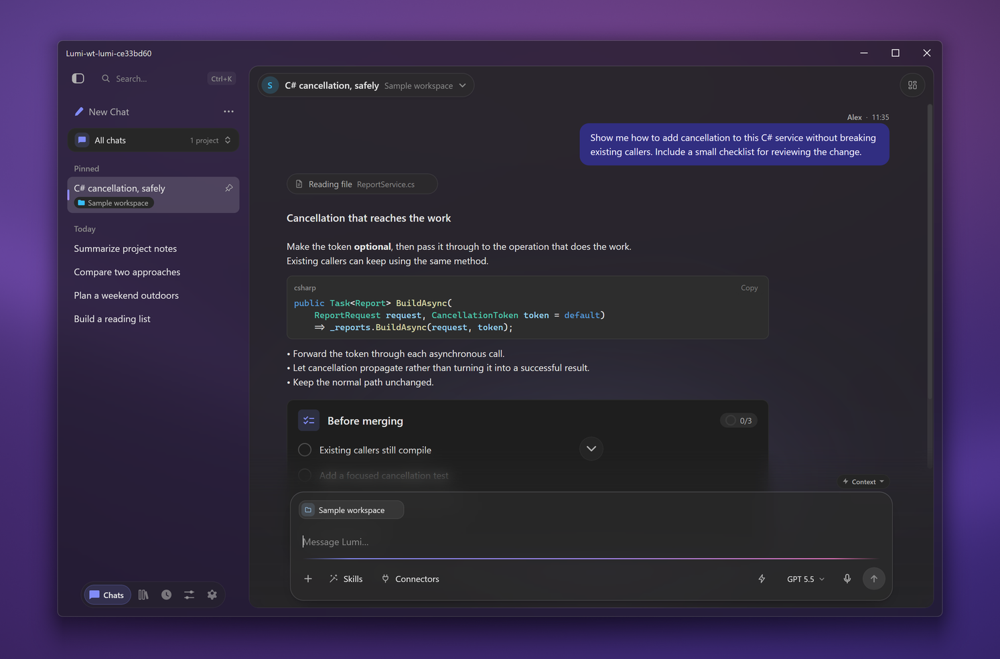

# Lumi ✨

**An open-source AI assistant for getting things done on your computer.**

Work on code, research a question, create files, or pick up a task from your phone.
Lumi is a native desktop application for **Windows, macOS and Linux**, built with
C#/.NET and [Avalonia](https://avaloniaui.net/), with an Android and mobile web
companion. The [GitHub Copilot SDK](https://github.com/github/copilot-sdk) supplies
the agent runtime.

[](LICENSE)

[Download](#download) | [Help](#getting-help) | [Build from source](#getting-started) | [Contribute](CONTRIBUTING.md) | [Detailed guides](#documentation)



*Actual UI at the default window size, with acrylic over an original purple
backdrop. This development build uses synthetic demo data; UI details may differ
from the latest packaged release.*

> **Use with care:** AI can make mistakes. Lumi can run commands, change or delete
> files, send data to connected services, and incur provider charges. Back up
> important data and review [permissions and risks](#tool-approvals) before
> granting access. Lumi is provided **"as is"**, without warranties, under the
> [MIT license](LICENSE).

## Download

**Desktop packages are self-contained: you do not need the .NET SDK to install
them.** Chat needs access to an AI account or a configured model endpoint;
[provider plans, limits and charges still apply](#ai-accounts).

| Platform | Download |
|---|---|
| Windows x64 | [Installer (.exe)](https://github.com/adirh3/Lumi/releases/latest/download/Lumi-win-Setup.exe) |
| macOS Apple Silicon (M-series) | [Installer (.pkg)](https://github.com/adirh3/Lumi/releases/latest/download/Lumi-osx-arm64-Setup.pkg) |
| macOS Intel | [Installer (.pkg)](https://github.com/adirh3/Lumi/releases/latest/download/Lumi-osx-x64-Setup.pkg) |
| Linux x64 | [AppImage](https://github.com/adirh3/Lumi/releases/latest/download/Lumi.AppImage) or [portable archive on the latest release](https://github.com/adirh3/Lumi/releases/latest) |
| Android ARM64 | [Companion APK on the latest release](https://github.com/adirh3/Lumi/releases/latest) |

[All downloads and release notes](https://github.com/adirh3/Lumi/releases)

Download links follow the latest published release. Android APK and Linux
portable filenames include a version, so those links open the release page:
under **Assets**, choose the file ending in `-android-arm64.apk` or
`-linux-x64-portable.tar.gz`. Match the phone app to your desktop release.

**Documentation scope:** this README and the detailed guides follow `main` and
may describe features not yet in a published package. Check the
[latest release notes](https://github.com/adirh3/Lumi/releases/latest) for what
has shipped.

### macOS

Download the installer above and open it, or paste the command for your Mac into
Terminal. **About This Mac** shows whether it has an Apple chip or an Intel processor.

**Apple Silicon:**

```sh
curl -fL "https://github.com/adirh3/Lumi/releases/latest/download/Lumi-osx-arm64-Setup.pkg" -o "$HOME/Downloads/Lumi-osx-arm64-Setup.pkg" &&
  open "$HOME/Downloads/Lumi-osx-arm64-Setup.pkg"
```

**Intel:**

```sh
curl -fL "https://github.com/adirh3/Lumi/releases/latest/download/Lumi-osx-x64-Setup.pkg" -o "$HOME/Downloads/Lumi-osx-x64-Setup.pkg" &&
  open "$HOME/Downloads/Lumi-osx-x64-Setup.pkg"
```

These download a package and open Apple's Installer; they do not run a remote
script or silently install anything. Follow the installer, then open Lumi from
Applications.

**Signing:** the [release workflow](.github/workflows/release.yml) can produce
unsigned macOS packages; signing and notarization are not guaranteed. Check the
release notes. If macOS blocks the installer or first launch, review the warning
and the download's source.
If you choose to proceed, use **System Settings > Privacy & Security > Open Anyway**
for that specific item. Do not disable Gatekeeper globally.

<a id="windows-installer"></a>

### Windows

Open the downloaded `.exe` and follow the installer. A
[portable ZIP](https://github.com/adirh3/Lumi/releases/latest/download/Lumi-win-Portable.zip)
is also available; extract it before running `Lumi.exe`.

<a id="linux-release-packages"></a>

### Linux

Download the AppImage, make it executable, and run it:

```sh
curl -fL "https://github.com/adirh3/Lumi/releases/latest/download/Lumi.AppImage" -o "Lumi.AppImage" &&
  chmod +x "Lumi.AppImage" &&
  ./Lumi.AppImage
```

AppImages need FUSE 2 (`libfuse2` or `libfuse2t64`, depending on your distribution).
If FUSE is unavailable, download the portable archive instead and save or rename
it as `Lumi-linux-x64-portable.tar.gz`. From that folder:

```sh
mkdir -p lumi-portable
tar -xzf "Lumi-linux-x64-portable.tar.gz" -C lumi-portable
chmod +x lumi-portable/Lumi
./lumi-portable/Lumi
```

The portable archive does not need FUSE, but still needs the platform's normal
native runtime libraries. See the [platform reference](docs/development.md#embedded-browser)
for the current source branch's browser dependencies and differences.

### Mobile conversations

Install the **Android APK from GitHub Releases**, not an app store, or use the
mobile web/PWA on iPhone or Android. There is **no native iOS app**. On the
desktop, open **Settings > Mobile** to enable access and pair the phone.
The desktop must stay running, awake and reachable: the phone is a companion,
not a standalone AI host.

Use Tailscale or an explicitly configured local-network connection for native
Android. **Microsoft Dev Tunnel mode is for the PWA only**, requires the owner's
Microsoft sign-in, and is not the native Android transport. See the
[mobile reference](docs/user-guide.md#mobile-conversations) and
[Dev Tunnel setup](docs/user-guide.md#private-mobile-web-app-with-microsoft-dev-tunnels);
UI details in those guides follow `main`.

## Features

- **Work on real tasks:** ask for code changes, shell commands, research or files,
  with the conversation and results in one place.
- **See what happened:** follow streaming replies, reasoning and tool activity
  instead of treating the assistant as a black box.
- **Keep useful context:** organize work into projects and reuse instructions
  through skills, custom agents and memories.
- **Connect your tools:** use MCP connectors and plugins for services you choose
  to add; those services can have their own setup and account requirements.
- **Keep work going:** use background jobs and continue desktop conversations
  from the paired Android app or mobile web client.

The [usage reference](docs/user-guide.md) covers the fuller, evolving feature set
on `main`, not a promise that every described control is in the current download.

## AI accounts

**Lumi is free and open source; AI usage is not automatically free or unlimited.**
GitHub Copilot is the default route. A supported external provider does not
inherently require GitHub sign-in, but the **Copilot agent runtime still executes
the agent**, including when another provider supplies the model.

**On `main`**, the guided **Settings > AI & Models > AI accounts** screen offers
the following connection choices. Availability in a packaged build depends on
its release; older installs may use manual endpoint/model configuration under
**Settings > BYOK** instead.

| Route | Account and cost boundary |
|---|---|
| GitHub Copilot | A GitHub account with Copilot access. Available models, allowance and billing depend on GitHub's plan and account eligibility. |
| ChatGPT plan sign-in | Uses OpenAI's supported [ChatGPT sign-in for open-source apps](https://developers.openai.com/siwc/token-sharing-open-source), not an API key. OpenAI determines eligible plans/models and plan limits; do not assume every ChatGPT account qualifies. Usage counts against that plan rather than API credits. |
| API providers, including OpenRouter and Microsoft Foundry | Bring the provider's API access and credits. API billing is separate: a ChatGPT subscription does not fund OpenAI API usage, Claude Pro/Max does not fund Claude API usage, and Foundry is not Microsoft 365 Copilot. |
| Local models, such as Ollama or LM Studio | Run a compatible model server yourself and select a model with suitable tool support. Local inference does not make every Lumi feature offline. |

See the [account guide](docs/user-guide.md#ai-accounts) for provider-specific setup,
model checks and **Use only your own accounts** on `main`. Cloud models,
background AI helpers and connectors can use account allowance or incur charges;
check the provider's own limits, billing and overage settings.

Chats and settings are stored locally, but model requests and connected tools
can send context to the providers/services you use. Local storage is not a
blanket offline, no-telemetry or privacy guarantee; third-party components have
their own policies.

## Tool approvals

Lumi can run commands, edit files and act through connected services with your
account's access. Review the tools and connectors you enable. **Approval is not
a sandbox.** The [permission modes and rules reference](docs/user-guide.md#tool-approvals)
describes `main`'s controls and defaults; it does not change the behavior of an
older installed release.

Keep backups and try unfamiliar workflows on disposable copies of your files.
Use the approval controls available in your installed release, review requests
and check the results. Approving an action does not guarantee that it is safe or
correct.

Desktop UI automation is **Windows-only**. Browser engines and capabilities
differ by platform; see the [embedded browser reference](#embedded-browser).

## Getting Started

**Building from source**, rather than installing a download:

<a id="prerequisites"></a>

You need Git and the [.NET SDK required by this checkout](CONTRIBUTING.md#tooling).
Ordinary desktop development does not require Node.js, Android tools or a
separately installed Copilot CLI.

<a id="clone"></a>
<a id="build--run"></a>

```sh
git clone --recurse-submodules https://github.com/adirh3/Lumi.git
cd Lumi
dotnet build Lumi.slnx --configuration Debug
```

**Before running, set an isolated `LUMI_APPDATA_DIR`.** The
[contributor guide](CONTRIBUTING.md#run-with-an-isolated-profile) has copy-paste
Windows, macOS and Linux launch commands, focused tests and optional mobile
tooling. Never use your everyday profile for development.

## Getting help

Start with the [usage guide](docs/user-guide.md), including
[AI account setup](docs/user-guide.md#ai-accounts) and
[connector troubleshooting](docs/user-guide.md#when-a-connector-cant-start).
The guides follow `main`; check the
[release notes](https://github.com/adirh3/Lumi/releases/latest) if your installed
app looks different.

- **Bugs and ideas:** use [GitHub Issues](https://github.com/adirh3/Lumi/issues/new/choose)
  and choose the bug-report or feature-request form.
- **Usage questions:** search existing issues first, then open a blank issue if
  the guides do not answer your question. Describe the task with non-sensitive
  sample data, not a private conversation or complete profile.
- **Provider accounts and charges:** your provider handles account eligibility,
  billing and usage limits; see [AI accounts](#ai-accounts).
- **Security or conduct concerns:** report privately through
  [SECURITY.md](SECURITY.md) or the [Code of Conduct](CODE_OF_CONDUCT.md#reporting-a-concern),
  rather than posting sensitive details in an issue.

Lumi is community-maintained; response and fix timelines are not guaranteed.

## Contributing

Start with [CONTRIBUTING.md](CONTRIBUTING.md): fork, clone with Strata, make a
focused change, validate it and open a PR. Documentation, translations and
reproducible bug reports are useful contributions too. Discuss larger changes
in [GitHub Issues](https://github.com/adirh3/Lumi/issues) before implementing them.
AI assistance is welcome; bulk or autonomous PR submissions require prior
maintainer approval. See the [contribution policy](CONTRIBUTING.md#ai-assisted-and-automated-contributions).
Share only redacted diagnostics, not private prompts or complete profiles.
Report suspected vulnerabilities through the [private security route](SECURITY.md),
not a public issue. Participation follows the [Code of Conduct](CODE_OF_CONDUCT.md).

## Documentation

The long-form reference is preserved below. **These guides follow `main` and
include unreleased work.** The links also keep the former README section anchors
usable.

| Topic | Reference |
|---|---|
| <a id="automated-qa"></a>Automated QA | [Deterministic merge checks, headed workflows and evidence](docs/testing.md) |
| <a id="voice-input"></a>Voice input | [On-device dictation, models and microphone setup](docs/user-guide.md#voice-input) |
| <a id="mcp-apps-and-copilot-canvases"></a>MCP Apps and Copilot canvases | [Workspace apps, bridge and trust boundaries](docs/user-guide.md#mcp-apps-and-copilot-canvases) |
| <a id="interactive-answers"></a>Interactive answers | [Forms, checklists, choices, calculators and quizzes](docs/user-guide.md#interactive-answers) |
| <a id="csv-file-previews"></a>CSV file previews | [Table preview behavior and limits](docs/user-guide.md#csv-file-previews) |
| <a id="navigation"></a>Navigation | [Pages, projects, memories and settings](docs/user-guide.md#navigation) |
| <a id="customize-and-discover"></a>Customize and Discover | [Skills, agents, plugins and connectors](docs/user-guide.md#customize-and-discover) |
| <a id="setup-suggestions"></a>Setup suggestions | [Optional setup discovery](docs/user-guide.md#setup-suggestions) |
| <a id="connectors-in-a-chat"></a>Connectors in a chat | [Selection and chat-scoped switches](docs/user-guide.md#connectors-in-a-chat) |
| <a id="when-a-connector-cant-start"></a>Connector errors | [Diagnostics and repair flow](docs/user-guide.md#when-a-connector-cant-start) |
| <a id="sharing-prompts-skills-agents-and-mcp-servers"></a>Sharing | [Prompts, skills, agents and connector packs](docs/user-guide.md#sharing-prompts-skills-agents-and-mcp-servers) |
| <a id="ai-features"></a>AI Features | [Automatic AI work, switches and model choices](docs/user-guide.md#ai-features) |
| <a id="copilot-telemetry-and-idle-sessions"></a>Telemetry and idle sessions | [Copilot telemetry settings and session lifetime](docs/user-guide.md#copilot-telemetry-and-idle-sessions) |
| <a id="unread-chats"></a>Unread chats | [Read/unread behavior](docs/user-guide.md#unread-chats) |
| <a id="resuming-chats-after-backend-history-errors"></a>History errors | [Resume and recovery boundaries](docs/user-guide.md#resuming-chats-after-backend-history-errors) |
| <a id="copilot-housekeeping-notices"></a>Housekeeping notices | [Diagnostic versus visible notices](docs/user-guide.md#copilot-housekeeping-notices) |
| <a id="pause-and-resume-chats"></a>Pause and resume | [Queues, interruption and restart behavior](docs/user-guide.md#pause-and-resume-chats) |
| <a id="background-work"></a>Background work | [Activity and stopping a session](docs/user-guide.md#background-work) |
| <a id="desktop-motion"></a>Desktop motion | [Animation behavior and reduced motion](docs/user-guide.md#desktop-motion) |
| <a id="lumi-tool-availability"></a>Tool availability | [Runtime tool-loading policy](docs/user-guide.md#lumi-tool-availability) |
| <a id="private-mobile-web-app-with-microsoft-dev-tunnels"></a>Microsoft Dev Tunnels | [Owner-only PWA setup and transport limits](docs/user-guide.md#private-mobile-web-app-with-microsoft-dev-tunnels) |
| <a id="lazy-mcp-initialization"></a>Lazy MCP initialization | [Catalogs, refresh and supported protocols](docs/user-guide.md#lazy-mcp-initialization) |
| <a id="embedded-browser"></a>Embedded browser | [WebView2/WebKit, dependencies, platform differences and fixture](docs/development.md#embedded-browser) |
| <a id="windows-computer-use-automation"></a>Windows computer use | [Desktop tools and limitations](docs/development.md#windows-computer-use-automation) |
| <a id="window-screenshots-and-the-desktop-workspace-page"></a>Desktop screenshots | [Capture and coordinate-click contracts](docs/development.md#window-screenshots-and-the-desktop-workspace-page) |
| <a id="validating-computer-use-from-the-repository"></a>Computer-use validation | [Existing test and benchmark runner](docs/development.md#validating-computer-use-from-the-repository) |
| <a id="repeatable-windows-desktop-benchmarks"></a>Desktop benchmarks | [Repeatable fixtures and evidence](docs/development.md#repeatable-windows-desktop-benchmarks) |
| <a id="app-icon"></a>App icon | [Code-drawn art and asset generation](docs/development.md#app-icon) |
| <a id="local-stratatheme-development"></a>Strata development | [Submodule references and licensing note](docs/development.md#local-stratatheme-development) |

## Tech Stack

- **.NET** with C#
- **Avalonia UI** — cross-platform desktop framework
- **CommunityToolkit.Mvvm** — MVVM source generators
- **GitHub Copilot SDK** — agentic LLM backend
- **[StrataTheme](https://github.com/adirh3/Strata)** — custom UI component library

Current dependency versions live in the [project file](src/Lumi/Lumi.csproj) and
[shared build properties](Directory.Build.props). Avalonia renders the
application's UI; "native desktop" does not mean OS-native widgets or a Native AOT
desktop build.

## Architecture

Lumi uses MVVM: views bind to view models, `CopilotService` owns SDK integration,
and `DataStore` owns persistence.

```text
src/Lumi/
  Models/       Domain entities
  Services/     Agent integration, storage and platform services
  ViewModels/   Chat and application state
  Views/        Avalonia views
```

See the [architecture reference](docs/development.md#architecture) and
[engineering guidance](AGENTS.md) for storage and runtime ownership details.

## License

Lumi's own source is [MIT-licensed](LICENSE). That license does not relicense
separate dependencies or the bundled Copilot runtime; their own licensing and
service terms apply. See the [Strata licensing note](docs/development.md#local-stratatheme-development),
[embedded-app bridge notices](src/Lumi/Assets/EmbeddedApps/LICENSES.txt) and
[font license files](src/Lumi.Mobile/Assets/Fonts).
