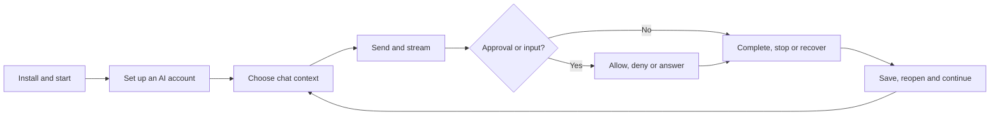

# Lumi 1.0 critical user journeys

This is the release acceptance catalogue: the important paths a person must be
able to complete, including the failures they must be able to recover from.
It covers desktop, the Android companion and the mobile web app.

**This is not a claim that every journey below already has an end-to-end test.**
The existing automation and its limits are described in [Automated QA](testing.md).
The catalogue is grounded in the current application surfaces and the product
behaviour documented in the repository, rather than a generic chat-app checklist.

## How to read this catalogue

- **P0:** a broken path blocks a first useful conversation, loses or corrupts
  work, crosses an account/data/permission boundary, or makes a supported core
  workflow unsafe or unusable.
- **P1:** an important advertised feature or routine workflow. A release must
  either support it correctly or explicitly scope the unsupported case.
- **D:** Lumi's part can be checked automatically with controlled responses and
  local fixtures. This does not mean the test exists today.
- **L:** a separate live-provider or hardware check is also needed to certify
  the external part. It must not be represented as covered by a fake provider.
- **K:** the installed package, actual device or OS integration must be checked;
  a successful Debug build or ViewModel test is not enough.

The `Checks` column identifies the required validation layers, not current
coverage. `D+L`, for example, means automate the deterministic application path
and separately identify the live boundary.

Each numbered row is a stable journey ID. Its success path and listed failure
branches are separate test cases where their observable outcomes differ. Do not
turn every row into one enormous test, or build a Cartesian product of every
OS, account, model and setting.

### The primary path

## 1. Install, start and onboard

| ID | Priority | User path | Observable acceptance and critical branches | Checks |
|---|---|---|---|---|
| START-01 | P0 | Download the correct desktop package -> install or extract -> launch Lumi. | The actual release artifact opens, reports the correct version and reaches a usable window. Missing native dependencies produce actionable guidance. Signing/trust status is reported honestly; an unsigned build is not called notarized or trusted. | D+K |
| START-02 | P0 | First launch -> welcome tour -> choose autonomy and AI -> finish -> start the suggested task. | The chosen name, language, approval mode, project and account are applied. The first task opens in the intended setup and can send a message. Completing onboarding is persisted. | D |
| START-03 | P0 | First launch without AI access -> skip optional discovery/personalization -> finish setup. | Deterministic fallbacks work. No account, workspace scan, model call or extra permission is silently granted. If an account is still required to chat, Lumi explains the next step rather than presenting a broken composer. | D |
| START-04 | P1 | Consent to selected discovery sources -> review suggested projects -> accept some. | Only allowed sources are read. Correct folders are proposed, worktrees are folded appropriately, existing projects are not duplicated, and rejected suggestions do not create projects. | D |
| START-05 | P1 | Settings -> replay Welcome Tour -> change some choices -> close it early. | Existing projects, memories, language and profile are not reset. Changes already accepted remain; closing does not leave onboarding blocking normal use. | D |
| START-06 | P0 | Close Lumi -> start it again with an existing profile. | Saved conversations, projects, accounts and settings remain available without reseeding data. Interrupted work is not falsely shown as successful. Startup remains usable when the AI backend is unavailable. | D+K |
| START-07 | P1 | Hide/minimize Lumi -> restore from tray, Dock, shortcut or a second launch. | The intended existing window returns with its chat and draft, rather than a duplicate session. Normal Quit and OS shutdown still exit. Platform-specific entry points are tested only where supported. | D+K |

## 2. Accounts, login and model access

| ID | Priority | User path | Observable acceptance and critical branches | Checks |
|---|---|---|---|---|
| AUTH-01 | P0 | Onboarding or Settings -> Sign in with GitHub Copilot -> browser verification -> authenticated Lumi. | Clicking the real sign-in control reaches the real browser handoff, the device-code UI is correct, completion refreshes the displayed identity and models, and a chat becomes usable. In deterministic CI, a local verification page must actually receive the browser request; a recorded launcher call alone is insufficient. Real GitHub authorization is a separate live check. | D+L+K |
| AUTH-02 | P0 | Start Copilot sign-in -> cancel, deny, let the code expire, lose the network or fail to open the browser -> retry. | The UI leaves its waiting state, preserves a usable retry/copy-URL route, ignores stale callbacks, and never claims authentication without a successful status refresh. Missing CLI and genuine authentication errors are distinct from transient service failures. | D+L |
| AUTH-03 | P0 | Reopen while signed in -> refresh identity -> sign out -> sign in again. | The correct stored identity is used and removed. Sign-out does not erase unrelated environment or GitHub CLI credentials. Failed sign-out does not clear the UI as though it succeeded. Existing native sessions are handled according to the account change. | D+L |
| AUTH-04 | P0 | Add a browser-based AI account, including ChatGPT plan sign-in -> authorize -> return to Lumi. | Correct provider URL, callback/state validation, account identity and credential storage are used. Denied consent, wrong account, stale callback, token renewal failure and cancellation do not connect the wrong account or expose a secret. | D+L+K |
| AUTH-05 | P0 | Add an API-key account, local model server or custom endpoint -> enter connection details -> save. | Credentials and endpoint/API configuration are validated. Secure storage is used where supported; any plaintext fallback requires explicit consent. Invalid keys, unavailable local servers and unsupported APIs leave the configuration editable and do not expose keys in UI or logs. | D+L |
| AUTH-06 | P0 | Discover models -> select models -> run the connection/model check -> connect. | The intended models are saved, and the configured account performs the model and read-only tool check. Empty catalog, manual model IDs and inaccessible models have explicit outcomes. Choosing to skip the model check is labelled unverified, not successful validation. | D+L |
| AUTH-07 | P0 | Choose account/model, reasoning effort and context window -> send -> switch choices for a later turn. | The actual runtime request receives the selected configuration; the completed message records what was used. Per-chat choices, defaults and pinned models remain distinct. A queued turn keeps its own explicit selection. Unsupported options are identified, not silently fabricated. | D+L |
| AUTH-08 | P0 | Enable Use only your own accounts -> chat and use automatic AI features. | Requests stay on permitted accounts, including helper sessions. Auto-review follows its documented Ask first fallback instead of making an unexpected Copilot reviewer request. Missing permitted model access does not silently route to an unwanted provider. | D |
| AUTH-09 | P1 | Open account usage/quota -> encounter a quota or subscription restriction -> resolve it. | Provider-reported data is distinguishable from estimates and unavailable data. ChatGPT plan allowance is not assigned invented API prices. Restrictions explain the action required without losing the conversation. | D+L |
| AUTH-10 | P1 | Replace a key, disable a model or remove an account used by a saved chat. | Pickers, pins, defaults and saved selections reconcile coherently. An unavailable selection is explained; existing work is not silently rerouted to another paid account. Secrets are not echoed back into editors or exports. | D |

## 3. Compose and send

| ID | Priority | User path | Observable acceptance and critical branches | Checks |
|---|---|---|---|---|
| CHAT-01 | P0 | New chat -> type -> Send button or the platform's send shortcut -> partial stream -> completed answer. | The real composer binding, send action, Copilot runtime and visible transcript are exercised. Text appears incrementally, busy/ready states are correct, the composer clears at the correct boundary, and the final answer is not a partial or duplicate. A local model proves wiring, not live-provider availability. | D+L |
| CHAT-02 | P0 | Send a question -> receive an answer -> send a follow-up relying on the preceding exchange. | The actual backend request/session retains prior context and the selected account/project. A scripted answer unrelated to the request is not sufficient proof of conversation continuity. | D+L |
| CHAT-03 | P0 | Send while attached work exists -> wait for the main assistant reply to finish -> send another turn. | Assistant readiness is separate from session/background activity. Child turn boundaries do not prematurely settle the main reply, and background work does not incorrectly disable a ready composer. | D |
| CHAT-04 | P0 | Send empty input, double-click Send or fail while the session is starting -> correct and retry. | No unintended empty or duplicate message/tool execution occurs. Failed submission remains visibly unsent or retryable; the draft and its context are not consumed as if delivery succeeded. | D |
| CHAT-05 | P0 | Add files/images through picker, drop or clipboard -> send -> use them in a response. | Correct content reaches the request, not merely a filename/chip. Unsupported, missing, moved or oversized files explain the failure without losing the draft. Attachments do not migrate to another chat or send twice. | D+K |
| CHAT-06 | P1 | Use Add, `/`, `@` or `#` -> select skills, agents, connectors, a project or other chats -> send. | The selected context affects the actual request and permitted tools. Removing a chip removes that context. Referenced chats are read at send time and are attached to exactly the intended message; a visible chip alone does not prove use. | D |
| CHAT-07 | P1 | Select answer text -> Reply -> send a follow-up -> jump back to the quote. | The correct quote/source is included and its link reveals the right historical message and highlight, including when it must be loaded from storage. Unrelated draft content is preserved. | D |
| CHAT-08 | P1 | Write a draft and choose context -> visit another chat/page -> return -> send. | Each chat retains its own draft, attachments and selections according to its persistence contract. Navigation and popup dismissal do not send, clear or cross-assign them. Persistent paused queues are tested separately from ordinary drafts. | D |
| CHAT-09 | P0 | The desktop, phone, job or another chat sends to the same conversation. | One live runtime owner handles that chat. Delivery/queueing follows the supported busy/paused policy, identity and context remain correct, and messages are not duplicated or delivered into a different conversation. | D |

## 4. Control running work and recover

| ID | Priority | User path | Observable acceptance and critical branches | Checks |
|---|---|---|---|---|
| RUN-01 | P0 | Start a streaming/tool-using turn -> Stop -> send a new message. | The requested work actually stops through the SDK; late events do not mutate the next turn. Partial output remains honest, tool cards settle, and the next send succeeds. A changed spinner alone is not proof of cancellation. | D |
| RUN-02 | P0 | Pause a running chat -> queue follow-ups -> restart if needed -> Resume. | Pause interrupts the turn and attached work before claiming it is paused. Queue order, attachments and reply context survive restart. Resume uses the saved session and documented empty-batch continuation, not a synthetic user prompt. Unrestorable paused sessions report failure instead of silently starting over. | D |
| RUN-03 | P0 | Main reply completes while a shell/agent continues -> inspect Background -> send a follow-up -> Stop session. | Live task/output/status belongs to the correct session. The ready assistant can accept a turn without aborting background work. Stop session ends that session's owned work, not another chat's or an unrelated OS process. | D |
| RUN-04 | P0 | Edit a recent or older user message -> resend from that point. | Stored/native history is rewound at the correct boundary. Parent/forked conversations are not altered. Failed interruption, failed truncation, missing history or a competing send preserves the original history and returns the edit to a usable draft. | D |
| RUN-05 | P0 | Regenerate an answer -> stop or let it finish -> continue chatting. | The intended prompt/context is reused and the transcript follows the defined regeneration behaviour. Interruption or resend failure does not erase the only valid answer or strand the conversation. | D |
| RUN-06 | P0 | Send a follow-up while busy -> steer or queue it -> change the composer -> let it deliver. | Delivery state is visible and truthful. Request identity, model, attachments and ordering remain those of the queued message, not a later composer selection. Failure is not silently labelled sent. | D |
| RUN-07 | P0 | Lose the provider/network, hit an auth/quota error or time out mid-turn -> recover or retry. | Error and recovery actions are explicit, committed transcript remains, and retry does not duplicate external effects or loop on a genuine authorization denial. Switching accounts is a deliberate choice. | D+L |
| RUN-08 | P0 | Return after idle-session release, stale native handle or restart -> continue an existing chat. | Saved ID and conversation context are resumed where available. A stale handle is not mistaken for missing history. Genuine unrecoverable history uses only the documented replay path and explains its limits. Permissions/configuration are installed again. Paused resume retains its stricter failure contract. | D |
| RUN-09 | P0 | Work in several chats and detached windows -> switch, close a surface or let caches expire. | Each chat retains one runtime owner. Closing a presentation surface does not kill unrelated or still-owned work. Background tasks, pending sends, questions, approvals and visible apps protect active sessions from idle eviction. | D+K |
| RUN-10 | P0 | Quit or crash during a turn -> relaunch -> inspect and continue. | Committed messages remain; incomplete actions are marked interrupted rather than successful or permanently running. Recovery never blindly replays a destructive tool action. Persisted pause intent and queues remain coherent. | D+K |

## 5. History, search and conversation navigation

| ID | Priority | User path | Observable acceptance and critical branches | Checks |
|---|---|---|---|---|
| HIST-01 | P0 | Complete messages/settings changes -> let autosave run -> exit -> reopen. | Independent reads of actual storage and a separate process show the exact completed messages, metadata and settings. A harness must not save on the application's behalf; disabling autosave must make the persistence assertion fail. | D |
| HIST-02 | P0 | Reopen a saved chat -> send a context-dependent follow-up. | Both restored UI history and actual runtime conversation continuity work. Merely rendering saved messages is not enough to certify that the next send resumes the right session/context. | D+L |
| HIST-03 | P0 | Open a very long chat -> scroll up/down -> expand work -> jump to old content. | Stored and live portions read consistently; answers, tools, agents, plans, sources, files and apps are not lost at exchange boundaries. Loading/realization preserves the shown anchor, and old surfaces can be released without blank or corrupt history. | D+K |
| HIST-04 | P1 | Search globally or within a chat -> choose a result from older history. | Correct stored and unsaved text is found; matching follows the documented query rules. The right chat/message is realized and revealed, including folded work. Clearing search preserves the draft and navigation state. | D |
| HIST-05 | P1 | Rename, pin, tag or move a conversation -> filter/sort -> reopen it. | The intended item and persisted metadata change, counts and filters reconcile, and no unrelated chat changes. Unread marks follow their documented app-session lifetime rather than being assumed persistent. | D |
| HIST-06 | P1 | Fork a whole conversation or branch from an older message -> continue the branch. | The branch starts at the correct point with coherent references and configuration. Original history stays unchanged and live work is not inherited. Missing/damaged backend history uses the documented safe copy/replay behaviour. | D |
| HIST-07 | P1 | Background reply/question arrives -> notification or unread inbox -> open the exact item. | The correct chat/reply is revealed and read state updates appropriately. Other unread work remains. Disabled/denied OS notifications leave the in-app route usable. Background notifications do not steal focus or silently switch the current conversation. | D+K |
| HIST-08 | P1 | Navigate Chats/Library/Jobs/Customize/Settings -> Back/Forward -> revisit an editor. | Destination, highlighted place, filters and saved navigation state agree. Drafts survive, deleted destinations are skipped, and navigation does not undo edits or replace the embedded browser's separate history. | D |

## 6. Approvals, questions and interactive answers

| ID | Priority | User path | Observable acceptance and critical branches | Checks |
|---|---|---|---|---|
| PERM-01 | P0 | Ask first -> tool proposes an action -> inspect it -> Allow or Deny. | The real runtime waits. No file/process/service effect occurs before approval; Allow produces the exact intended effect and Deny prevents it. The decision reaches the requesting tool and the card becomes an accurate receipt. | D |
| PERM-02 | P0 | Choose default/project/chat approval modes and rules -> create or resume a session. | Effective precedence and native enforcement match the UI. Never and Always-ask rules remain effective in Full access. Auto-review has a truthful unavailable/own-accounts fallback; reading a harmless/read-only tool is classified correctly. | D+L |
| PERM-03 | P0 | Remember an approval -> use it -> Forget it -> request the action again. | Remembering occurs only after runtime acceptance. Native cached allowances are cleared/reinstalled so Forget takes effect in open sessions, not just after restarting. Rule scope does not leak across chats/projects. | D |
| PERM-04 | P0 | Several chats request approval -> answer one -> stop/disconnect/close its owner -> click an old card. | Only the correct request can be answered once. Expired/stale cards cannot grant future work. Requests retire safely when their owner ends, without an implicit Allow. | D |
| PERM-05 | P0 | Agent asks a question -> choose/type an answer -> submit or cancel. | The correct waiting task receives the exact submitted answer once. Selection survives view rebuilds. Switching chats, stopping or session loss cannot send an answer to a different request. | D |
| PERM-06 | P0 | A task requests a form/shortlist with `ask_input` -> validate -> submit, cancel or stop. | Valid input returns as a tool result to that same task, not an unrelated new turn. Submitted values become a frozen receipt. Invalid, cancelled, expired or restarted requests cannot silently resume or consume an unrelated draft. | D |
| PERM-07 | P1 | Explore a completed form/checklist/results/calculator/quiz -> submit its explicit action -> reopen or fork. | Local edits do not call the model. State persists, the submitted snapshot is immutable and source links stay valid. User checkmarks are not claims of agent execution. Malformed definitions show an error rather than disappearing. | D |
| PERM-08 | P0 | A job/other chat requests a restricted action while the user is absent. | Wait for me pauses/notifies; Skip that action produces the native unavailable/skip result and a receipt. No unattended grant is invented. Approvals are not presented as a sandbox; an unrelated approval, remembered rule or widget submission is not blanket consent for future purchases, messages or deletion. | D |

## 7. Projects, folders and coding workspaces

| ID | Priority | User path | Observable acceptance and critical branches | Checks |
|---|---|---|---|---|
| PROJ-01 | P0 | Create a project -> set instructions/folder -> save -> start a chat in it. | Values persist and the actual runtime gets the intended working directory and context. A visible label or successful editor save alone is not proof of runtime use. Missing/inaccessible folders explain how to recover. | D |
| PROJ-02 | P0 | Switch projects or move a chat -> send in each project. | Instructions, brief, memories, folder and approval policy belong to the chosen project. Explicit chat references may share context; accidental cross-project context must not. Counts, selected project and displayed chat remain consistent. | D |
| PROJ-03 | P1 | Edit a project -> navigate away/back -> Save, Discard or Delete. | Editor drafts survive surface recreation, Save persists the intended item, Discard restores saved values, and destructive choices require confirmation. Related chats and counts follow the explicit deletion contract without accidental transcript loss. | D |
| PROJ-04 | P0 | Select/create a linked worktree -> start or continue a coding chat -> switch checkouts. | Chat workspace, runtime folder and displayed branch agree. Existing uncommitted work and other worktrees are untouched. No shared stash or broad cleanup is used to make the operation succeed. Busy-session configuration changes follow ownership rules. | D+K |
| PROJ-05 | P1 | Enable the coding project's daily repository update -> run with clean/dirty nested submodules. | Only the configured branch and recorded submodule commits are used. Dirty/staged/unrecorded work blocks unsafe updates; already-current checkouts can repair missing submodules. Failures are visible and local work is preserved. | D |
| PROJ-06 | P1 | Accept a setup recommendation -> configure the suggested account/connector/project -> use it. | Recommendation sources are consented, accepting reaches the right setup, dismissal does not perform setup, and later discovery remains available. A successful setup is verified by actual capability use, not disappearance of the suggestion. | D |

## 8. Skills, agents, connectors and discovery

| ID | Priority | User path | Observable acceptance and critical branches | Checks |
|---|---|---|---|---|
| CAP-01 | P1 | Create/edit a skill -> attach or invoke it -> send a task using it. | Saved markdown and the actual active skill content agree. Add/remove/rename and personal/project/plugin origins resolve according to the capability catalog; a chip alone does not prove prompt/tool activation. | D |
| CAP-02 | P0 | Create/select an agent with instructions, skills and a tool allowlist -> use it. | The real request uses the intended persona and permissions. Authored empty/restricted tool sets are respected and cannot be bypassed by routing through another visible persona or child agent. | D |
| CAP-03 | P1 | Open a built-in/external/plugin capability -> try to edit -> Make a copy. | Read-only provenance is clear, editing cannot overwrite the external source, and the copy is a separate editable Lumi item. Switching project/catalog refresh does not create duplicate or stale selections. | D |
| CAP-04 | P0 | Add a stdio or remote connector -> configure secrets/auth and tools -> enable -> invoke a tool. | The actual configured connector answers. Only selected/enabled tools are exposed; arguments and returned effects are correct. Keys/env/headers are stored and redacted appropriately, and a disabled connector does not start behind the user's back. | D+L |
| CAP-05 | P0 | A connector fails to start, times out or needs login -> inspect the issue -> retry, authenticate or disable it. | A precise recoverable state replaces false connected/success UI. No secret leaks, runaway duplicate server processes or wrong-server fallback occur. Lazy first use and concurrent chats share the intended server ownership. | D+L |
| CAP-06 | P1 | Discover -> browse/search marketplace or registry -> install/add -> use -> uninstall/remove. | The accepted plugin goes through SDK installation, registry additions become the right saved connectors, and capabilities refresh in chats. Failure/cancellation is explicit; removing a plugin removes its contributions without deleting unrelated user copies. | D+L |
| CAP-07 | P0 | Share a skill/agent/connector pack or code -> preview on another profile -> import reviewed items. | Export redacts credentials and inappropriate machine-specific secrets. Preview makes executable capabilities/trust clear, cancellation has no effect, and import does not run a command or overwrite an external capability merely by opening the file/code. | D |
| CAP-08 | P1 | Completed answer -> Share prompt -> review/edit -> copy -> use in another chat. | The draft retains relevant refinements, is standalone, and excludes secrets/irrelevant personal paths and unrelated turns. Nothing is copied/sent before the explicit action; draft-generation failure leaves a usable recovery route. Live wording quality is separate from deterministic data-boundary checks. | D+L |

## 9. Results, work details, files and Library

| ID | Priority | User path | Observable acceptance and critical branches | Checks |
|---|---|---|---|---|
| WORK-01 | P0 | Watch reasoning/tool progress -> receive an answer -> expand the work summary. | Progress, answer and tool/run ownership are distinguishable. Completed/failed/interrupted states match actual work; a tool update or child answer is not misrepresented as the main final answer. Folding never loses steps or actionable errors. | D |
| WORK-02 | P1 | Open a plan or agent run from live or old history -> inspect steps/output -> return. | Correct task, latest activity, status and details appear. Older runs read their stored steps, not only the live tail. Closing releases heavy detail without corrupting the summary or dropping continuing work. | D |
| WORK-03 | P0 | Receive an announced file -> preview/open it -> find it again after restart. | The file exists and has the intended contents/type; the chip opens that exact output. Missing/moved/unsupported files produce truthful guidance rather than a false preview/success. Source conversation links remain correct. | D+K |
| WORK-04 | P1 | Open Library -> filter/search across older work -> select an item -> open its source chat. | Whole stored history is represented, not only loaded messages. Filters/counts agree, the selected artifact is correct, and navigating to its source realizes the correct older exchange. Empty/missing-file states are usable. | D |
| WORK-05 | P1 | Open Workspace files, changes, sources and Git details -> inspect an older edit/diff. | Rows, line counts, paths, citations and underlying edits agree with the transcript and correct repository. Summary-only storage reads are not written back as incomplete messages, and previewing does not change the file/repository. | D |
| WORK-06 | P1 | Read/copy/select rich text, code, tables, diagrams, charts and images -> paste or reply. | Actual rendered content is selectable/readable; Plain text/Markdown/Rich text copy the intended content and current widget values instead of raw JSON. Quotes and source links survive older history. Unsupported rendering is an explicit error, not a blank answer. | D+K |
| WORK-07 | P1 | Preview CSV/text/image/PDF or another supported file -> sort/search/refresh/open externally. | Correct source and content are shown without editing it. Encoding, quoted/multiline CSV, truncation notices and missing/native-handler cases are honest. External opening targets the intended file and leaves the conversation intact. | D+K |

## 10. Embedded browser, MCP Apps and canvases

| ID | Priority | User path | Observable acceptance and critical branches | Checks |
|---|---|---|---|---|
| WEB-01 | P0 | Open the browser from a chat -> navigate to a page -> read it and capture it. | The real OS browser engine shows the requested page; DOM observations and actual PNG pixels agree. Native availability/prerequisite failures are reflected consistently in UI, tools and prompt. This is distinct from external login-browser handoff. | D+K |
| WEB-02 | P0 | Find -> click/type/select/fill/press/wait -> execute a known batch on a dynamic page. | Actual page effects are checked, not tool success text alone. Coordinated fields retain valid values; stale/replaced targets and document changes fail safely. A failed batch stops at the right step and never blindly replays an executed submit. | D |
| WEB-03 | P1 | Open/switch/close tabs and popups -> go Back -> continue an authenticated flow. | Stable tab identity and per-tab page state are preserved, and an operation's observation belongs to its original tab. Cookie/session behaviour follows the documented platform contract, including Linux per-tab session-cookie limits. | D |
| WEB-04 | P0 | Consent to import cookies from a selected profile -> use them -> reset cookies. | Only the selected source and matching Lumi browser profile are affected. HttpOnly/secure/path/expiry semantics are preserved. Reset reaches initialized peers in that profile without opening or modifying unrelated profiles. Cancellation/failure does not claim a completed import. | D+L+K |
| WEB-05 | P1 | Upload one/multiple files -> verify the web form -> download a produced file where supported. | Exact bytes/names reach the input without relying on an OS picker; page events occur. A supported download produces the correct file. Native platforms without embedded downloads report unsupported behaviour rather than false success. | D+K |
| WEB-06 | P1 | Dock/undock the browser -> resize/change UI scale or display -> capture/interact again. | Real pixels, physical bounds, page zoom and hit targets remain aligned beneath the correct chrome. Transferring a host does not dispose the moved browser, duplicate it or expose another chat's page. | D+K |
| WEB-07 | P0 | Tool opens an MCP App/canvas -> use its UI -> call its chat-scoped tool -> close Workspace -> reopen. | The real bridge reaches ready/error states, uses the existing connection and correct tool exchange, and cannot cross chat/origin/capability boundaries. Reopen restores identity without replaying the original side-effecting tool. Desktop loopback interfaces are not blindly forwarded to the phone. | D+K |
| WEB-08 | P1 | Reload or close a canvas -> restart Lumi -> reopen the saved app card. | App loading and session resume are explicit, supported actions/lifecycle events remain consistent, and closed instances are not falsely shown as live. Missing Node/extension/resource and bridge startup failures provide a recovery route. | D+K |

## 11. Windows computer use

| ID | Priority | User path | Observable acceptance and critical branches | Checks |
|---|---|---|---|---|
| DESK-01 | P0 | Ask Lumi to inspect a named app -> act through native controls -> read the result. | The correct window/dialog is targeted and actual effects are verified. Background-safe actions do not steal focus; minimized restoration and virtualized/offscreen controls follow the supported contract. Other platforms do not advertise unavailable Windows tools. | D+K |
| DESK-02 | P0 | An action needs foreground keys/pointer -> grant foreground permission -> act using a fresh capture. | Target/focus is verified before input. Stale captures, changed geometry/DPI, covered points, privilege boundaries and unrelated windows cannot receive fallback input. Completed/irreversible actions are not blindly replayed after uncertain observation. | D+K |
| DESK-03 | P1 | Inspect screenshots/action status in Desktop Workspace -> lock/minimize/switch apps. | The page is passive and chat-scoped, timestamps are truthful, and screenshots are from the intended window. Locked-session, protected/elevated-window and unsupported-capture failures are explicit rather than fabricated images or claimed input. | D+K |

## 12. Jobs and unattended work

| ID | Priority | User path | Observable acceptance and critical branches | Checks |
|---|---|---|---|---|
| JOB-01 | P0 | Create/edit a timed job -> inspect next run -> run/pause/resume -> restart Lumi. | Schedule, local-time semantics, target chat/project/model and persisted activation agree. A paused job does not run, one-shot completion does not repeat, and actual failed execution is not shown as completed. | D |
| JOB-02 | P0 | Create a script wake job -> script waits -> exits -> linked chat receives its result. | The script is launched once, the right stdout/stderr/exit status wakes the right chat once, and it does not silently become a recurring poller. Stop/cancel and failed-script paths remain distinguishable from success. | D |
| JOB-03 | P0 | Observe another chat's selected lifecycle event -> event occurs -> target chat wakes. | Source and target differ, filters are enforced and duplicate events do not duplicate a wake. The session-idle contract waits for attached work, not merely a parent assistant step boundary. Self-trigger loops are prevented. | D |
| JOB-04 | P0 | A job runs against an open/busy/cached chat -> user visits or sends while it works. | The single live chat owner is reused or correctly acquired/released. Drafts, pending questions/approvals and background work are not lost through temporary surface creation or disposal. Pause and unattended-policy rules still apply. | D |
| JOB-05 | P1 | View Jobs/history or a wake event -> inspect failure -> stop, retry or change the job. | Instructions, output and status belong to the right run, edits persist and user actions affect the intended future/current work. A status label is not proof that an external action succeeded. | D |

## 13. Memories, briefs and automatic AI

| ID | Priority | User path | Observable acceptance and critical branches | Checks |
|---|---|---|---|---|
| CTX-01 | P0 | Create/edit/delete a memory -> start chats inside and outside its project. | Only the correct global/project scope enters the actual prompt. User edits/deletions persist, unrelated projects do not inherit private project facts, and explicit cross-chat references remain distinguishable from implicit context. | D |
| CTX-02 | P1 | Finish a reply -> automatic memory extraction -> inspect the result or disable extraction. | Evidence-based fixture inputs produce the intended stored changes; disabling prevents future automatic invocations. Model errors do not break the main reply or invent saved facts. Live extraction quality is separately assessed. | D+L |
| CTX-03 | P1 | Nightly/catch-up brief review -> read/correct/clear a brief -> Update now. | Intended scopes and dates are reviewed from stored history, quiet scopes are skipped, failed scopes remain retryable, and concurrent user edits are not overwritten blindly. Brief text and category/search/project links stay coherent. | D+L |
| CTX-04 | P0 | Start a project/global chat after other chats have changed. | The correct brief plus newer-activity context enters the prompt, without leaking an unrelated project's private brief or rebuilding an existing session's cached prompt on every update. A summary is not mistaken for the complete source history. | D |
| CTX-05 | P0 | Disable automatic AI or choose per-feature models -> use chat, titles, suggestions and other helpers. | Each feature follows its documented trigger, next-invocation switch and model/account routing. Disabled helpers do not keep launching future requests; a background-model change does not silently change the user's chat model. Usage/AI involvement remains transparent. | D+L |

## 14. Voice dictation

| ID | Priority | User path | Observable acceptance and critical branches | Checks |
|---|---|---|---|---|
| VOICE-01 | P0 | First microphone click -> accept/defer download -> download/cancel/retry. | No model download starts before consent. Platform-appropriate assets are size/hash-verified, progress/cancellation is honest, and failed/corrupt downloads do not replace a valid cache or disable ordinary text chat. | D+K |
| VOICE-02 | P1 | Start dictation -> speak/pause -> choose language -> finish -> use it offline. | Known recorded audio can check decoding deterministically; real microphone/permission/device checks remain separate. Text appends correctly, loading does not lose initial audio, non-speech does not fabricate words, and speech stays on the device. | D+L+K |
| VOICE-03 | P0 | Dictate while editing -> finish-and-send, cancel, switch chat or lose microphone access. | Final words flush once into the intended draft; cancel restores the appropriate prior draft without overwriting newer manual edits. Dictation never inserts into another chat or sends on its own. Denied/no/silent audio leaves clear recovery and usable typing. | D+L+K |

## 15. Settings, accessibility and OS integration

| ID | Priority | User path | Observable acceptance and critical branches | Checks |
|---|---|---|---|---|
| SET-01 | P1 | Change theme/accent/material/text size/density/presence -> preview -> restart -> Restore default look. | Changes appear consistently in app, icon and tray where applicable, persist correctly, and restore affects only appearance rather than credentials/projects/chat preferences. System-theme changes are handled without losing work. | D+K |
| SET-02 | P1 | Search Settings -> open a matching page -> change/revert a setting -> navigate away/back. | Search reaches the actual intended control, not just a label. Values, modified markers and defaults agree with saved snapshots. Only active page UI is retained while ViewModel values/drafts remain intact. | D |
| SET-03 | P1 | Use English/Hebrew, keyboard/assistive navigation, larger text, a narrow window and supported DPI scales. | Reading order, focus, accessible control names, shortcuts and primary actions remain usable without clipping. Cmd/Ctrl and keyboard hints are native to the OS; popups/tooltips cannot swallow critical clicks or leave focus trapped. | D+K |
| SET-04 | P1 | Configure launch-at-login, tray behaviour or a supported global hotkey -> restart the OS/app. | Actual registration/restore behaviour matches the setting and supported platform. Quit/shutdown still exits. Isolated test/debug profiles never alter the developer's real autostart registration. | D+K |

## 16. Android and mobile web app

| ID | Priority | User path | Observable acceptance and critical branches | Checks |
|---|---|---|---|---|
| MOB-01 | P0 | Desktop Settings -> enable Mobile -> choose local Wi-Fi, Tailscale or Dev Tunnel -> get a usable connection route. | Only applicable apps/transports are offered, current status/link/QR agree, errors explain the missing prerequisite, and no unapproved installation/system/network change occurs. Disabled phone access does not leave an active listener presented as off. | D+L+K |
| MOB-02 | P0 | Select Dev Tunnel -> consent to CLI acquisition if needed -> Microsoft sign-in/fallback -> owner-only link ready. | Official acquisition is verified; cancellation leaves safe state. Native broker and explicit browser/device-code fallback are distinct, account identity is correct, tunnel/port grants stay owner-only, and assets/APIs are not made anonymous to make login/installability work. GitHub identity is not substituted for Microsoft tunnel authentication. | D+L+K |
| MOB-03 | P0 | Install/open official Android APK or the web app -> scan/open link -> pair with desktop. | Correct release/download and deep-link fallback are used. Single-use/expired/wrong pairing codes and attempt limits are enforced; the separate tunnel sign-in does not bypass Lumi pairing. Saved device credentials are protected. | D+L+K |
| MOB-04 | P0 | On the phone, choose a setup/project/model -> send -> receive the desktop's streamed answer. | The real desktop runtime owns the request, selected context/configuration is preserved and the phone shows actual partial/final activity. New-chat creation, optimistic rows and acknowledgements do not duplicate a command or mutate global defaults. | D+K |
| MOB-05 | P0 | Open old mobile history while an answer streams -> switch chats -> return. | Stored pages and incoming text merge without lost/repeated chunks, incorrect order or cross-chat content. Lists/read state remain coherent without discarding already loaded history; setup/picker state is truthful. | D+K |
| MOB-06 | P0 | Background/rotate the phone, change networks, lose the desktop or restart it -> reconnect. | In-flight acknowledgement recovery checks original request identity before changing a newer draft or adopting a chat. It does not blindly resend side-effecting requests. Backoff, explicit Retry and expired credentials have distinct, usable outcomes. | D+L+K |
| MOB-07 | P0 | Answer an approval/question/form from the phone -> return to desktop or reconnect. | The correct pending task is answered exactly once and the submitted receipt survives refresh. Cancelled/stale/unsupported-host interactions cannot grant work or silently create a different task. | D+K |
| MOB-08 | P0 | Open/download a chat file or image remotely -> try an unrelated path or app URL. | Only explicitly eligible files from the authorized chat are exposed; bytes and names are correct. Arbitrary PC paths, unannounced/failed reads and desktop loopback canvas URLs are not promoted to downloadable resources. | D+K |
| MOB-09 | P0 | Revoke one paired device or disable phone access -> try an existing connection again. | A revoked device's next command/download or stream reconnection is rejected; an existing connection cannot keep issuing authorized work. Other devices are not accidentally revoked. Turning access off stops the service, and reconnect cannot restore a revoked bearer credential. | D+K |
| MOB-10 | P1 | Use phone/tablet/fold/landscape layouts and Android keyboard -> resume -> update/reload the PWA. | Composer, Send/Stop and model/approval controls remain accessible. IME geometry is fresh after backgrounding. Cached startup, manifest authentication and web-app update flows do not falsely authenticate an unpaired user or silently drop a pending draft. | D+L+K |
| MOB-11 | P1 | From mobile, inspect/edit supported projects, agents, skills or memories; toggle supported jobs/connectors. | Changes reach the desktop and return correctly. Built-in/read-only/unsupported items remain so; old-host compatibility is explicit rather than inventing editable capabilities or metadata. | D+K |

## 17. Updates, deletion and storage recovery

| ID | Priority | User path | Observable acceptance and critical branches | Checks |
|---|---|---|---|---|
| DATA-01 | P0 | Check/download an update -> inspect release notes -> restart, retry or cancel a blocked update. | Correct signed/unsigned artifact and version are used, progress/errors are honest, and a failed update leaves a runnable installation/profile. Blocking processes are identified and only explicitly approved, correct processes are closed. Real packaged upgrade and preserved profile are tested, not only an update simulation. | D+L+K |
| DATA-02 | P0 | Upgrade a legacy profile -> import chats -> open/write during or after import. | Metadata and readable messages survive, tail/history ordering is correct, interrupted import resumes and unreadable sources remain retryable. Missing history is labelled, not mistaken for a genuinely empty chat or silently rewound by an invalid position. | D+K |
| DATA-03 | P0 | Open a damaged/locked database or run out of disk space -> recover/retry. | Original recoverable data is preserved, readable rows are salvaged and losses are disclosed. Storage failure is not shown as a successful save; later starts can continue the supported recovery without overwriting the only remaining source. | D+K |
| DATA-04 | P0 | Delete a chat or Clear all chats -> cancel or confirm -> restart. | Cancellation changes nothing. Confirmation removes the intended stored/indexed/legacy data and dependent views so deleted chats do not resurrect. Other settings, credentials and unrelated chats are not accidentally removed. | D |
| DATA-05 | P0 | Clear memories or reset settings -> inspect confirmation -> cancel or confirm. | The action and scope are explicit, match the stored result and survive restart. A narrower reset does not accidentally erase chats/projects/accounts, and the UI does not show stale data as though deletion failed or succeeded differently. | D |
| DATA-06 | P0 | Close/restart after repeated use, live work or a failed send -> reopen the same profile. | Storage writes and owned native resources settle safely; stale handles/locks do not permanently block reopening. Saved pause queues and committed messages survive; interrupted external side effects are not automatically repeated. Unrelated app instances/processes remain untouched. | D+K |
| DATA-07 | P1 | Encounter a crash/error -> inspect/copy diagnostic information -> recover or report it. | The user gets useful, accurate context and a route back to work where possible. Diagnostic/export content does not unexpectedly reveal credentials or silently upload private conversation data. | D+K |

## 18. Cross-cutting variants

Apply these where they change the outcome, not as a full combinatorial matrix:

| Dimension | Required distinctions |
|---|---|
| Desktop host | Windows x64, Linux x64, macOS Intel and Apple Silicon. Verify applicable installed artifacts separately from headed Debug fixtures. |
| Native availability | macOS browser minimum version, Linux browser/native libraries, Windows-only computer use/global hotkeys, and honest unsupported download/capture/preview behaviour. |
| Account routing | Copilot, another hosted account, local/custom endpoint, signed out, expired credential, quota denial and Use only your own accounts. |
| Runtime state | New session, ready cached session, assistant busy, background work only, paused, idle-released, restarted and genuinely unavailable native history. |
| Transcript shape | Empty/tiny chat, many stored exchanges, one very large exchange, old tools/runs/apps and unsaved changes. |
| Window/input | Main/detached surface, chat switch, narrow/high-DPI layout, keyboard command modifier, RTL language and interrupted navigation. |
| Work origin | Composer, phone, background job and another chat. Ownership, pause and unattended-approval policy differ. |
| Failure boundary | Before submission, after remote acceptance but before acknowledgement, mid-stream, while waiting for input/approval and during persistence. |
| Data/profile | Fresh, existing, legacy, partially damaged and isolated test profile. Tests must never read/write the developer's real profile. |
| Consent | Accepted, declined, cancelled, expired, revoked and not yet requested. An unavailable dependency must never silently broaden permission. |

### What constitutes proof

- A browser-opening check needs an observable browser request/window/page, not
  just an `OpenUrl` spy. Real provider authorization remains a distinct check.
- A send needs the real composer/action, received runtime request and visible
  streamed/final reply; a canned answer displayed directly by the test is not proof.
- A tool decision needs independent filesystem/process/server effects, not
  merely a green card or changed spinner.
- Persistence needs independent storage reads and a separate process. The test
  must not save or seed the state it is claiming the application preserved.
- Resume needs a context-dependent subsequent request, not only a restored
  transcript. Stopping needs actual termination/settled ownership, not only
  a disabled button.
- Import, discovery and model/capability selection need the actual accepted
  configuration/content to reach its consumer, not only a selected list row.
- Mobile recovery needs request-identity and exact command-count assertions;
  automatically resending until something appears to work can duplicate effects.
- Package certification needs the installed artifact, real native dependencies
  and OS integration. Building or creating an installer is not an install,
  upgrade, signing, notarization or device certification.
- Failures, cancellations, denied consent and unsupported cases need their own
  explicit expected outcomes. They are not generic passes or skipped assertions.

## 19. Current coverage boundary

At the existing QA baseline (`a27d16cb`), the headed smoke harness proves these
specific slices on the four native desktop targets:

| Existing headed scenario | Journey slice it proves |
|---|---|
| `navigation` | Selected paths through Settings, Chats, the project drawer and Customize Skills/Projects, not every navigation destination. |
| `project-save` | Actual project editor fields, save, clean editor state and independently observed index values. It does not alone prove every project/runtime-folder branch. |
| `ai-settings` | Master automatic-AI off/on/off transitions, all switchable feature flags and persisted values, not every helper's model or real invocation. |
| `chat-streaming` | Actual composer input/Send, real Copilot runtime, visible partial/final reply, composer clearing and selected-project retention, using a local scripted model. |
| `approval-denied` / `approval-allowed` | Native file-tool waiting, correct approval UI, denied absence and exact allowed file bytes. Other rule/mode branches require their own tests. |
| `persist-checkpoint` | Application-owned autosave of completed replies, not a harness-initiated chat save. |
| `restart` | Separate-process restoration and visible saved content/settings, not a context-dependent send after restart. |
| Autosave-disabled negative control | The same preceding flows must succeed and persistence alone must fail when autosave is disabled. |
| Native browser fixture | Bounded navigation/forms/tabs/cookies/uploads/viewport/pixel/docking flows and Windows-specific checks. This does not cover external account sign-in. |

CoreQA and the full suite add component/headless coverage for many other rows,
including settings snapshots, prompt/configuration routing, permissions,
storage/search, onboarding, editing/interruption failure handling, background
lifetime, management, and mobile protocol/client flows. That is valuable but
must not be relabelled as a complete headed user journey.

In particular, **Copilot sign-in/browser handoff, live provider authorization,
complete headed stop/edit/regenerate/attachment flows, installed upgrades,
microphone/OS-permission checks, and real Android/PWA user journeys are not
certified merely because the existing workflows are green**.

## 20. Turning the catalogue into maintainable tests

1. Pick a journey and its important branch, and identify the actual owning
   application flow. Reuse existing components/harnesses rather than cloning it.
2. Record the journey ID, preconditions, controlled dependencies and independent
   pass/fail oracle beside the test. Map existing tests before adding duplicates.
3. Use deterministic component tests for policy/data boundaries, headed tests
   for actual control-to-runtime wiring, package/device tests for native
   integration, and explicitly labelled live checks for external authorization
   or hardware. One layer is not a substitute for the others.
4. Add a negative control where a helper could accidentally manufacture success,
   particularly saving, authentication, tool effects or command deduplication.
5. Keep the PR gate focused and deterministic. Extend nightly/manual/release
   lanes with the appropriate headed/package journeys; P0 is a product-risk
   classification, not a requirement to perform every live sign-in on every PR.
6. Keep expected failures explicit and evidence machine-readable. Do not hide
   an assertion behind retries, silently skip a critical case, or turn
   unsupported behaviour into a success-shaped fallback.

Changes to this catalogue do not implement the tests or change the current CI
gates. Add coverage through the maintenance rules in [Automated QA](testing.md).
